<!--
  ██      ██
  ██     ██
  ██    ██
  ██   ██
  ██  ██
  ██   ██
  ██    ██
  ██     ██
  ██      ██

  // KhaledSaeed18 / the back room

  You opened the source, so you are probably an engineer. Hello.

  This file only places the sheets. Every image on the page is printed by
  press/build.mjs: type set as outlines in the site's own fonts, every tone
  from one 4x4 Bayer lattice, every corner square. A GitHub Action pulls a
  fresh printing every hour.

  This file is generated by press/readme.mjs; edit that instead.

  00101111 01110010 01100101 01100111 01101001 01110011 01110100 01100101 01110010
  8 bits a letter; visit what it spells on khaledsaeed.tech

  The fastest way to reach me is still contact@khaledsaeed.tech
-->

<!-- sheet 00. the masthead -->
<a href="https://khaledsaeed.tech" title="khaledsaeed.tech"><picture><source media="(prefers-color-scheme: light)" srcset="https://raw.githubusercontent.com/KhaledSaeed18/KhaledSaeed18/prints/masthead-light.svg"></picture></a>

<!-- sheet 01. about -->
<picture><source media="(prefers-color-scheme: light)" srcset="https://raw.githubusercontent.com/KhaledSaeed18/KhaledSaeed18/prints/rule-01-light.svg">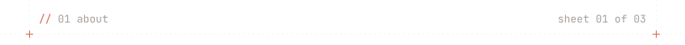</picture>

### I design and build products end to end.

Interfaces people enjoy using, backends that hold up in production, and the tooling in between. Some of it ships with a team, some of it stays private, and some of it I give away. All of it gets the same standard: clear behaviour, honest errors, and nothing left for the next person to guess.

TypeScript is my common language across web, backend, mobile and desktop. When a tool belongs on my Mac, I write it in Swift; on Linux, in Rust. I am completing an M.S. in Computer Engineering at the Lebanese International University, and going deeper into AI and machine learning.

I tell computers what to do, and <ruby><del>sometimes</del><rt>usually</rt></ruby> they listen.

<!-- sheet 02. contact -->
<picture><source media="(prefers-color-scheme: light)" srcset="https://raw.githubusercontent.com/KhaledSaeed18/KhaledSaeed18/prints/rule-02-light.svg">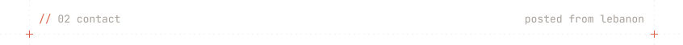</picture>

### Say hello. I read everything.

Email is the fastest way to reach me, at [contact@khaledsaeed.tech](mailto:contact@khaledsaeed.tech). For anything that needs a conversation, [book a call](https://cal.com/khaledsaeed).

<a href="mailto:contact@khaledsaeed.tech?subject=Hello%20from%20GitHub" title="write to contact@khaledsaeed.tech"><picture><source media="(prefers-color-scheme: light)" srcset="https://raw.githubusercontent.com/KhaledSaeed18/KhaledSaeed18/prints/postcard-light.svg">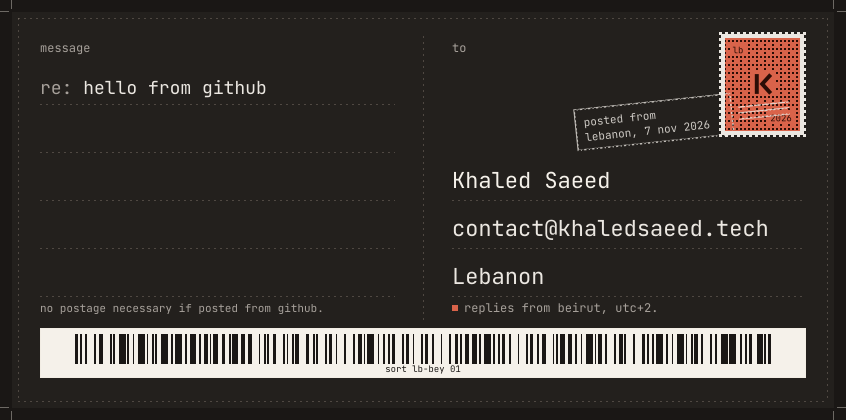</picture></a>

<a href="mailto:contact@khaledsaeed.tech" title="email / contact@khaledsaeed.tech"><picture><source media="(prefers-color-scheme: light)" srcset="https://raw.githubusercontent.com/KhaledSaeed18/KhaledSaeed18/prints/stamp-01-email-light.svg"></picture></a>
<a href="https://cal.com/khaledsaeed" title="book a call / cal.com/khaledsaeed"><picture><source media="(prefers-color-scheme: light)" srcset="https://raw.githubusercontent.com/KhaledSaeed18/KhaledSaeed18/prints/stamp-02-call-light.svg"></picture></a>
<a href="https://khaledsaeed.tech/khaled-saeed.vcf" title="save contact / vcard"><picture><source media="(prefers-color-scheme: light)" srcset="https://raw.githubusercontent.com/KhaledSaeed18/KhaledSaeed18/prints/stamp-03-vcard-light.svg"></picture></a>
<a href="https://www.linkedin.com/in/khaled-s-saeed/" title="linkedin / khaled-s-saeed"><picture><source media="(prefers-color-scheme: light)" srcset="https://raw.githubusercontent.com/KhaledSaeed18/KhaledSaeed18/prints/stamp-04-linkedin-light.svg"></picture></a>
<a href="https://x.com/KhaleddSaeed18" title="x / @KhaleddSaeed18"><picture><source media="(prefers-color-scheme: light)" srcset="https://raw.githubusercontent.com/KhaledSaeed18/KhaledSaeed18/prints/stamp-05-x-light.svg"></picture></a>
<a href="https://dev.to/khaledsaeed18" title="dev / khaledsaeed18"><picture><source media="(prefers-color-scheme: light)" srcset="https://raw.githubusercontent.com/KhaledSaeed18/KhaledSaeed18/prints/stamp-06-dev-light.svg"></picture></a>
<a href="https://www.instagram.com/khaledd.saeed" title="instagram / khaledd.saeed"><picture><source media="(prefers-color-scheme: light)" srcset="https://raw.githubusercontent.com/KhaledSaeed18/KhaledSaeed18/prints/stamp-07-instagram-light.svg"></picture></a>
<a href="https://discord.com/users/1496301841774805004" title="discord / khaledsaeed18"><picture><source media="(prefers-color-scheme: light)" srcset="https://raw.githubusercontent.com/KhaledSaeed18/KhaledSaeed18/prints/stamp-08-discord-light.svg"></picture></a>

<!-- sheet 03. the colophon -->
<picture><source media="(prefers-color-scheme: light)" srcset="https://raw.githubusercontent.com/KhaledSaeed18/KhaledSaeed18/prints/rule-03-light.svg">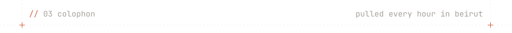</picture>

<!-- the slug: the colour bar at the tail of the sheet -->
<a href="https://khaledsaeed.tech/register" title="off register by 3 units"><picture><source media="(prefers-color-scheme: light)" srcset="https://raw.githubusercontent.com/KhaledSaeed18/KhaledSaeed18/prints/slug-light.svg">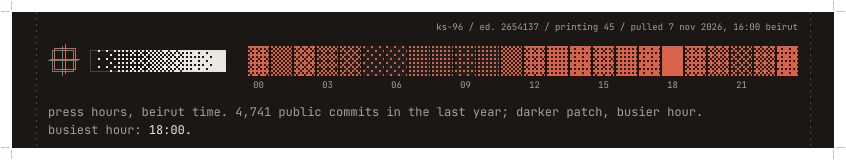</picture></a>

Selected work is pinned below. Everything else is printed at [khaledsaeed.tech](https://khaledsaeed.tech).
